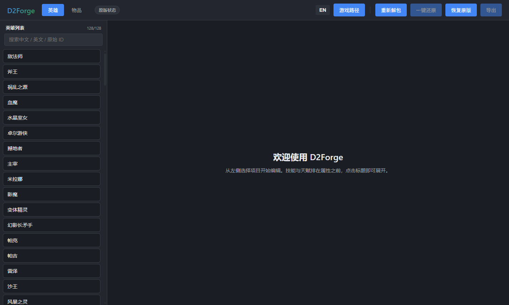
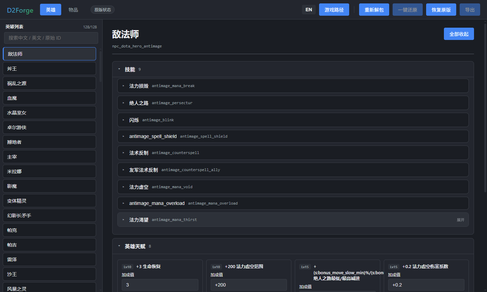
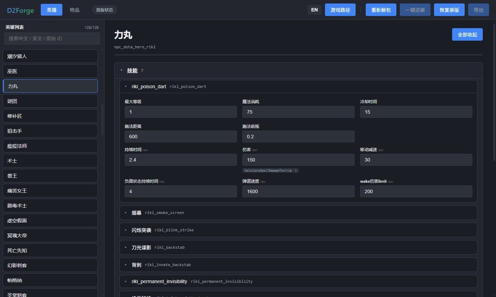
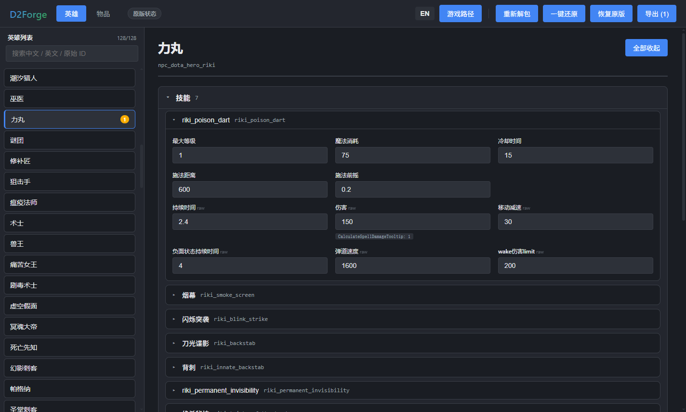
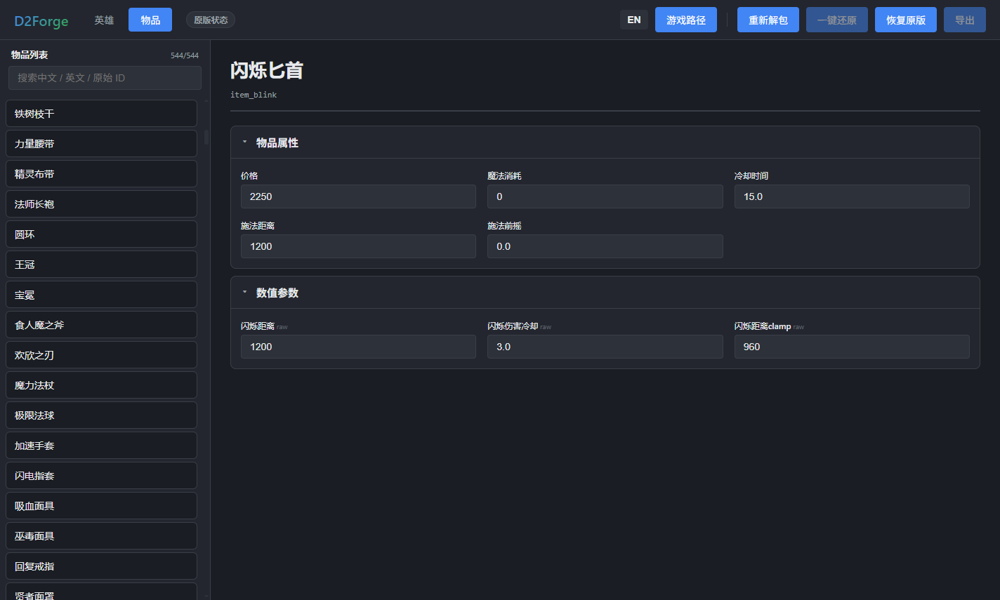

# D2Forge

**一个现代化的 Dota 2 离线模式数值编辑器。** 直接读写游戏自身的 VPK 数据包，修改英雄属性、技能数值、天赋加成与物品属性，并在游戏更新后保留你的改动。

A modern desktop editor for Dota 2's offline-mode numbers — hero stats, ability values, talent bonuses, and item properties. It reads the game's own VPK archives, writes back only what you changed, and survives game patches. Built with Electron + React.



**[下载最新版](https://github.com/SkylineLch/D2Forge/releases/latest)** · [从源码运行](#从源码运行) · [使用流程](#使用流程)

---

## 目录

- [为什么做这个](#为什么做这个)
- [功能](#功能)
- [界面](#界面)
- [环境要求](#环境要求)
- [下载与安装](#下载与安装)
- [从源码运行](#从源码运行)
- [使用流程](#使用流程)
- [工作原理](#工作原理)
- [游戏更新后怎么办](#游戏更新后怎么办)
- [项目结构](#项目结构)
- [开发与验证](#开发与验证)
- [常见问题](#常见问题)
- [范围与限制](#范围与限制)
- [免责声明](#免责声明)
- [Credits](#credits)

---

## 为什么做这个

Dota 2 的玩法数据全部打包在 `game/dota/pak01_dir.vpk` 及其分卷里 —— 一张压缩过的、带索引的二进制归档。想改一个技能的伤害数值，传统做法是：解包整个归档（数 GB）、手动翻 `scripts/npc/*.txt` 找那个字段、改完再重新打包、最后想办法让游戏优先加载你的包。

D2Forge 把这套流程收进一个图形界面：

- 不用解包。应用读取 VPK 索引后按需取文件，只把你**实际改动**的那几个文件重新打包进一个几百 KB 的覆盖包。
- 不用翻文件。改成「英雄 → 技能 → 数值」的层级浏览，带中英混合搜索。
- 不用怕更新。游戏打补丁后重新索引一次，还能对上的改动继续生效，对不上的会明确报告而不是静默写坏。

范围限定：**只改数值。** 不涉及模型、贴图、动画、音效、技能逻辑与 AI 行为。

## 功能

**结构化浏览**
- 英雄 → 技能 / 天赋 / 属性三条主线，物品 → 属性。
- 每个板块是可折叠手风琴，默认只展开技能与天赋，属性、攻击、防御折叠着 —— 不用一路滚轮扫过几十个字段。
- 选中英雄后列表位置保持不变，不会跳回顶部。

**混合搜索**
- 一个搜索框同时匹配中文名、英文名、内部原始名：`幻影`、`anti`、`npc_dota_hero_axe` 都能命中。

**天赋树编辑**
- 按 Lv10 / Lv15 / Lv20 / Lv25 分档列出该英雄的 8–10 个天赋，直接改加成数值。
- 自动剔除神杖 / 魔晶标记（`special_bonus_scepter` / `special_bonus_shard`），它们不是天赋。

**改动可见**
- 每个被改动的字段都高亮，并在旁边常驻显示原始默认值。
- 工具栏的「导出」按钮常驻显示待写入的改动条数。

**中英双语**
- 界面可切换；技能名、物品名、数值标签取自游戏自身的本地化表，和你在游戏里看到的一致。
- 技能数值标签的中文覆盖率 **98%**；剩余 2% 是 `is_global`、`has_multishot` 这类布尔开关，本身不适合编辑。

**三级可逆**
| 操作 | 作用范围 | 典型场景 |
|---|---|---|
| 单个字段重置换 | 一个数值 | 改错了某个值 |
| **一键还原** | 清空所有待写入改动 | 本轮试完，重新开始 |
| **恢复原版** | 卸载覆盖包 + 逐字节复原 `gameinfo.gi` | 切回联网原版打天梯 |

后两个就是你在「改过的离线版」和「纯净联网版」之间来回切换的开关。

**游戏更新不丢改动**
- 重新索引 VPK 后，自动比对你的历史改动：底层数值没变的继续生效，变了的列出来并附上游戏现值。

## 界面

选英雄后，技能与天赋排在属性之前，每个板块可单独展开：



展开技能后逐个数值编辑，改过的字段高亮并显示原值：



天赋按等级分档，直接改加成：



物品面板同构：



## 环境要求

- **Windows 10 / 11**（当前只支持 Windows —— 覆盖机制依赖 `gameinfo.gi` 的注入路径与 CRC32 补偿，逻辑本身跨平台，但没有在 macOS / Linux 上验证过）
- **已安装 Dota 2**（Steam 版）
- **Node.js 18+** —— 仅从源码运行时需要；用打包好的 exe 不需要

## 下载与安装

**[➜ 下载最新版](https://github.com/SkylineLch/D2Forge/releases/latest)**

| 文件 | 大小 | 说明 |
|---|---|---|
| `D2Forge.1.0.1.exe` | 约 105 MB | **免安装版** —— 单个文件，双击即用。想随手带着走选这个。 |
| `D2Forge.Setup.1.0.1.exe` | 约 116 MB | **安装版**（NSIS）—— 可选安装目录，有开始菜单项。长期使用选这个。 |

两个都是独立包，不需要另装 Node.js。文件名里的点来自 GitHub 对发布资产的命名规则（空格会被替换成点号），下载后可以随意改名，不影响使用。

**自己打包**（也不想信任别人编译的二进制时）：

```bash
npm install
npm run dist
```

产物在 `release/`：`win-unpacked/D2Forge.exe`（免安装，整个文件夹约 350 MB）与 `D2Forge Setup 1.0.1.exe`。

## 从源码运行

```bash
npm install
npm run app        # 开发模式：Vite 热更新 + Electron
npm start          # 跑已构建的 ./dist（需先 npm run build）
npm run preview    # 重新构建后启动
```

**首次启动要指路。** 点右上角「游戏路径」，选到：

```
Steam\steamapps\common\dota 2 beta\game
```

选到上一级 `...\dota 2 beta` 或下一级 `...\dota 2 beta\game\dota` 都能自动纠正。选错时会有明确提示而不是白屏。

## 使用流程

一次完整的「改数值 → 进游戏验证」：

1. **选路径** —— 首次启动会记住，之后自动加载。
2. **改数值** —— 英雄标签页选英雄 → 展开技能或天赋 → 点数值编辑。改过的字段立刻高亮。
3. **退出游戏** —— 导出前必须完全关闭 Dota 2。游戏运行时点「导出」会直接报错并提示你先关游戏（工具栏也会出现「游戏运行中」的橙色标记）。
4. **导出** —— 点「导出」，应用把改动写进 `game/0test/pak01_dir.vpk`，同时在 `gameinfo.gi` 插入覆盖路径。左上角状态从 `原版状态` 变成 `覆盖已启用`。
5. **进游戏** —— 开**本地房间 / 单机对机器人**。改动只在这类对局生效。
6. **切回联网** —— 打完点「恢复原版」（同样要先退游戏）。状态回到 `原版状态`，`gameinfo.gi` 逐字节复原，可以正常打天梯。

## 工作原理

### 覆盖机制

Dota 2 的 `gameinfo.gi` 里有一个 `SearchPaths` 块，按顺序列出引擎要搜索的数据目录。向其中插入一条 `Game 0test`，引擎就会**优先**读这个目录下的 `pak01_dir.vpk`，命中你改过的文件，其余文件继续回落到原版包。

路径基准容易搞错：`SearchPaths` 里的路径相对**游戏根目录** `game/` 解析（同块的 `Game dota` 就指向 `game/dota`），所以 `Game 0test` 对应 `game/0test/`，不是 `game/dota/0test/`。1.0.1 修的就是这个 —— 之前覆盖包写深了一层，引擎找不到就静默回落原版，表现是「导出成功但游戏里没变化」。如果你之前用过旧版本，首次启动会自动清理掉放错位置的那份残留。

所以覆盖包只需要包含你改过的那几个文件 —— 通常 1–5 个，几十 KB 到几百 KB。

### CRC32 校验

引擎会校验 `gameinfo.gi` 的 CRC32。直接插入一行会改变文件长度和哈希，导致游戏拒绝加载配置。

处理方式是**反向求解**：插入 `Game 0test` 那一行后，在文件末尾追加一段注释 `//` + 4 字节填充，然后计算这 4 个字节应该取什么值，才能让整个文件的 CRC32 等于修改前算出的目标值。CRC32 是可逆的 —— 已知除最后 4 字节外所有字节的余数，能直接解出这 4 字节。

写入后会**重新计算一遍校验**，不匹配就抛错而不是留下一个坏掉的文件。原始文件在动手前备份为 `gameinfo.gi.orig`，`恢复原版` 时逐字节还原。

备份万一丢了（Steam 验证文件完整性、手动清理目录），`恢复原版` 还有兜底：直接从当前文件里剥掉 `Game 0test` 行和那段注释填充，结果与从未修改过的文件一致。

### 只重写改动的文件

`kv-parser.cjs` 解析 Valve KeyValues（KV1）文本，但**不做完整重序列化** —— 那样会丢注释、丢缩进、把整个文件格式化一遍。改为定位目标字段在原文中的字节偏移，就地替换 `value` 值。一个有两处改动的英雄文件，其余内容保持原样。

### 改动历史

每次改动记录为 `{英雄/物品 ID, 字段路径, 原值, 新值}`，存在应用数据目录里。重新索引 VPK 时拿它和游戏现值比对：一致 → 继续生效；不一致 → 报警告并给出游戏现值，让你决定是否保留。

## 游戏更新后怎么办

Dota 2 打补丁后，`pak01_dir.vpk` 会整体重排，旧的覆盖包里的文件可能对不上新版本。

1. 点「重新解包」——应用重新读 VPK 索引，重建英雄 / 物品 / 技能列表。
2. 应用自动比对历史改动。弹窗会给出结果，形如：

   ```
   388,116 个条目，保留 2 项修改
   ```

   保留下来的直接可用；被跳过的会在「查看详情」里逐条列出：哪个英雄的哪个字段、为什么跳过、游戏现值是多少。
3. 需要的话手动修正被跳过的改动，重新「导出」。

## 项目结构

```
electron/
  main.cjs          Electron 主进程、IPC 处理、路径解析与纠正
  vpk.cjs           VPK 读写（v1 + v2 头、分卷归档）
  kv-parser.cjs     Valve KeyValues（KV1）词法与序列化
  data-store.cjs    索引 VPK，对外提供英雄 / 物品 / 技能 / 天赋
  exporter.cjs      应用改动、生成覆盖包、比对历史改动
  gameinfo.cjs      gameinfo.gi 注入与 CRC32 补偿
  localization.cjs  按需查询游戏的本地化 token
  labels.cjs        字段名 → 中文标签的推断与清洗
  change-store.cjs  跨会话持久化改动历史
src/                React 界面
  App.jsx           主界面与状态管理
  App.css           样式
tools/              独立探针脚本，用于验证各子系统（不属于应用运行时）
scripts/launch.cjs  启动器，启动前剥离 ELECTRON_RUN_AS_NODE
docs/screenshots/   README 用截图
```

## 开发与验证

项目全程用探针脚本验证，不靠肉眼看。`tools/probe-*.cjs` 是端到端验证夹具：读你本机的游戏文件、做一次往返编辑、断言产出的 VPK 结构完整。

```bash
node tools/probe-fields.mjs        # 字段发现
node tools/probe-export.mjs        # 导出 → 覆盖包
node tools/probe-export-path.cjs   # 覆盖包落点：game/0test 而非 game/dota/0test
node tools/probe-talents.cjs       # 天赋解析
node tools/probe-coverage.cjs      # 翻译覆盖率，产出 tools/untranslated.json
node tools/probe-crc.mjs           # gameinfo.gi 的 CRC32 补偿
node tools/probe-game-process.cjs  # dota2.exe 进程检测（正反两向）
node tools/probe-single-instance.cjs # 单实例锁
```

**UI 自检。** 应用内置一个脚本化的冒烟测试，会走一遍真实使用顺序（编辑 → 导出 → 重新解包 → 一键还原 → 恢复原版），截 9 张图，并断言 20 项条件：

```bash
node scripts/launch.cjs --ui-check
```

产出在 `ui-check/`（打包版写在 `%APPDATA%/D2Forge/ui-check/`）。退出码反映结果 —— 源码版与打包版均为 **20/20 通过**。

## 常见问题

**启动报 `bad option: --ui-check` 或直接闪退**
本机环境变量里有 `ELECTRON_RUN_AS_NODE=1`，这会让 Electron 以纯 Node 模式启动、不加载界面。`scripts/launch.cjs` 会剥掉它；直接运行 `electron` 时手动 `set ELECTRON_RUN_AS_NODE=` 再启动即可。

**`打开游戏失败：ENOENT ... pak01_dir.vpk`**
路径选错了。要选到 `game` 目录（`...\dota 2 beta\game`），不是 `dota 2 beta` 也不是 `dota`。选前两者应用会尝试自动纠正；如果还是报错，说明 Steam 库不在默认位置，手动找到真实路径。

**导出了但游戏里没变化**
先看工具栏状态：`覆盖已启用` 才说明写入成功。如果点导出就报错，多半是游戏还在运行 —— 逐个退出 Dota 2（含最小化到后台、以及 Steam 里的残留进程），看到「游戏运行中」标记消失再导出。排除这两点后仍无变化，请确认是**本地房间 / 单机对机器人**；匹配对局不加载客户端覆盖。

**又开了一个 D2Forge，提示「已有实例运行」**
这是设计如此。同一时间只允许一个实例，避免两边同时改写同一份改动集导致互相覆盖。第二次启动会把已经开着的那个窗口提到前台并闪烁提示，然后自己退出。

**「恢复原版」之后状态还显示 `覆盖已启用`**
旧版本有这个 bug（备份路径与还原路径不一致，打包后尤其明显），已在 1.0.1 修复。如果你用的是旧构建，手动检查 `game/0test/` 目录与 `game/dota/gameinfo.gi` 里是否残留 `Game 0test` 行，删掉即可。

**改动能覆盖到多少个英雄 / 物品？**
当前索引到 128 个英雄。技能数值来自英雄文件，天赋数值来自技能文件里的 `AbilityValues` 修饰键，两者都已覆盖。

**中英文混排出现 `额外attack速度` 这类词**
字段名由词素表推断，少数复合词没覆盖到。这类只影响标签可读性，不影响数值读写。想要更好的翻译可以往 `electron/labels.cjs` 的 `KEY_PART_ZH` 里补词。

## 范围与限制

- **只支持 Windows。**
- **只改数值。** 技能逻辑、AI、模型、音效都不在范围内。
- **只对本地对局生效。** 联机匹配使用 Valve 服务端数据，客户端覆盖不参与。
- **字段中文标签是推断结果**，不是官方译名。数值读写完全不依赖它，标签只是显示层。
- **游戏大版本更新后可能需要重新索引。** 应用会提示，但极端改动（官方重命名了技能内部 ID）会让个别历史改动无法匹配。

## 免责声明

本项目仅供**本地离线 / 单机对机器人**的数值试验与学习使用。

- 不要在联机对局中使用 —— 覆盖对匹配无效，但修改游戏文件本身可能违反 Valve 的服务条款。
- 覆盖机制会写入你的游戏安装目录。应用在动手前会备份原始文件，但**仍建议自行备份 `game/dota/gameinfo.gi`**。
- 使用本软件造成的任何后果（账号风险、文件损坏、游戏异常）由使用者自行承担。

与 Valve 无关联，未获其认可或背书。Dota 2 是 Valve Corporation 的商标。

## Credits

覆盖机制（`0test` 搜索路径）的思路来自 [Dota2Editor](https://github.com/ado-cs/Dota2Editor)。本项目是独立实现：结构化界面、VPK v2 支持、改动跨更新保留、就地文本编辑与 CRC32 补偿。

`LICENSE`: MIT。
