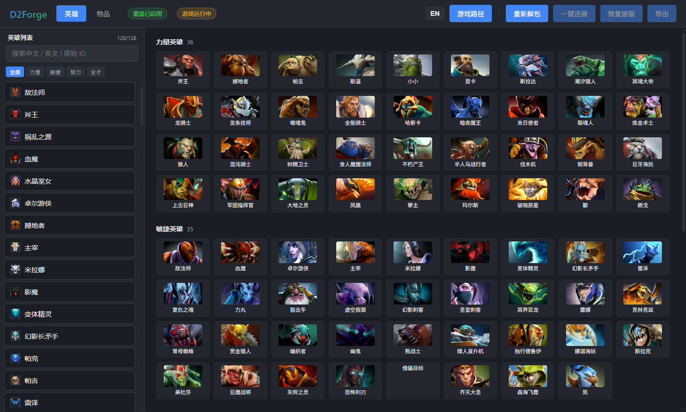
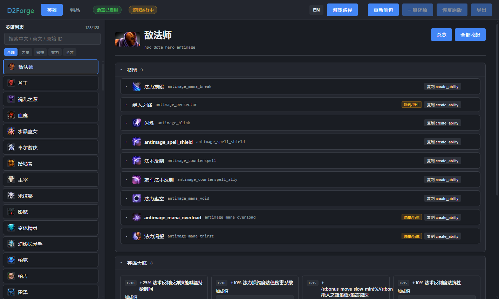
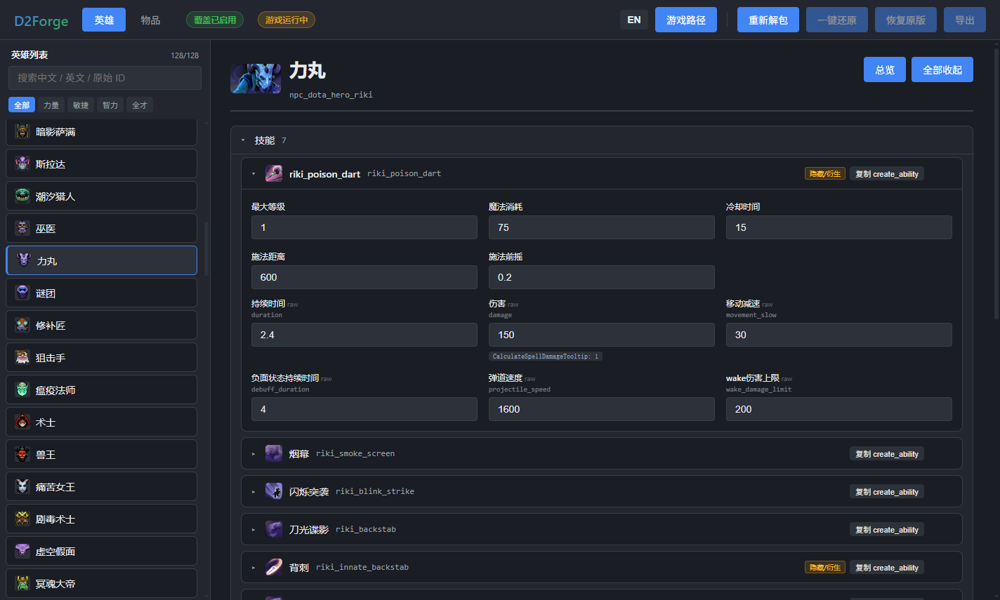
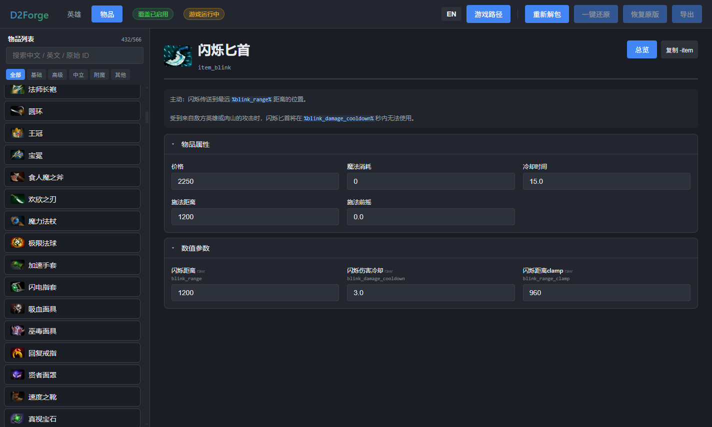

# D2Forge

**一个现代化的 Dota 2 离线模式数值编辑器。** 直接读写游戏自身的 VPK 数据包，修改英雄属性、技能数值、天赋加成与物品属性，并在游戏更新后保留你的改动。

A modern desktop editor for Dota 2's offline-mode numbers — hero stats, ability values, talent bonuses, and item properties. It reads the game's own VPK archives, extracts icons locally, writes back only what you changed, and survives game patches. Built with Electron + React.



**[下载最新版 v1.1.0](https://github.com/SkylineLch/D2Forge/releases/latest)** · [核心特性](#核心特性) · [界面预览](#界面预览) · [下载与安装](#下载与安装) · [使用流程](#使用流程) · [工作原理](#工作原理)

---

## 为什么做这个

Dota 2 的玩法数据全部打包在 `game/dota/pak01_dir.vpk` 及其分卷里。想在单机人机（例如搭配 `bots/fretbots`）里调高某个技能伤害或修改装备数值，传统做法是手动解包数 GB 归档、翻找 `scripts/npc/*.txt`、再重新打包并注入加载路径。

D2Forge 把整套流程收进一个直观的桌面界面：

- **无需手动解包**：按需索引 VPK，仅把你**实际改动**的文件重新打包进几百 KB 的覆盖包 `game/0test/pak01_dir.vpk`。
- **所见即所得**：内置图标提取缓存、按游戏原生逻辑分组、技能官方描述对照与中英混合搜索。
- **不惧版本更新**：游戏更新后点一次「重新解包」，未变动的历史修改自动延续，冲突项明确报告。

范围限定：**只改数值。** 不涉及模型、贴图、动画、音效、技能逻辑与 AI 行为。

---

## 核心特性

### 1. 游戏原生逻辑分组 + 图标墙总览
- **英雄四属性分组**：自动读取 `AttributePrimary`，按 **力量 / 敏捷 / 智力 / 全才** 分区展示。
- **物品商店与中立池分组**：直接解析游戏自带的 `scripts/shops.txt` 与 `scripts/npc/neutral_items.txt`，拆分为 **基础物品 / 升级物品 / 中立物品（带 `T1`–`T4` 级标）/ 中立附魔 / 其他（已移除与配方）**。
- **总览图标墙 + 极速搜索双模式**：未选中项目（或点击右上角「总览」）时展示直观的图标网格；左侧保留带图标的搜索列表，支持中文、英文与原始 ID 混合检索（如 `幻影`、`core`、`npc_dota_hero_axe`）。
- **本地图标自动缓存**：首次打开或「重新解包」时，后台调用内置 `Source2Viewer-CLI` 增量导出英雄、物品与技能图标至 `%APPDATA%/D2Forge/icons/`，游戏更新后仅同步变更贴图。

### 2. 技能 / 物品描述与参数分层
- **官方描述内嵌**：展开技能或物品时，顶部直接展示游戏官方描述、**神杖**与**魔晶**说明，并将 `%变量名%` 高亮显示，方便与下方字段一一对照。
- **核心词条 vs 内部参数分层**：自动区分「游戏内可见词条」与「引擎内部/隐藏参数（`raw`）」，内部参数默认收进独立折叠区（有修改时自动展开），并在字段下方保留原始英文 key。
- **天赋树独立编辑**：按 Lv10 / Lv15 / Lv20 / Lv25 分档列出英雄天赋，自动剔除神杖/魔晶标记。

### 3. 游戏内指令一键复制
- **顶部工具栏 `fretbots脚本`**：一键复制 `sv_cheats 1; script_reload_code bots/fretbots`，开局即用。
- **物品详情页**：一键复制 `-item <id>`。
- **英雄技能栏**：一键复制 `create_ability <id>`，并对标记为 `HIDDEN` / `NOT_LEARNABLE` 的衍生子技能标注 `隐藏/衍生` 风险提示。

### 4. 完整中英双语与高覆盖汉化
- 同时索引 VPK 内的 `abilities_schinese.txt`、`items_schinese.txt` 与 `dota_schinese.txt`，支持大小写无关查找及新版 `:n` 词条后缀。
- 现役商店物品、中立物品与英雄中文覆盖率达 **100%**；所有改动字段高亮并常驻显示原始默认值。

### 5. 三级可逆与安全防护
| 操作 | 作用范围 | 典型场景 |
|---|---|---|
| **单个还原** | 还原单个字段 | 改错了某个数值 |
| **一键还原** | 清空所有待写入改动 | 本轮试完，重新开始 |
| **恢复原版** | 卸载 `0test` 覆盖包 + 逐字节复原 `gameinfo.gi` | 切回纯净联网环境打天梯 |

---

## 界面预览

选定英雄后展示图标、技能列表（含技能图标与 `create_ability` 一键复制）、天赋树与属性分组：



展开技能后显示字段、原始英文 key 与派生标签：



物品页展示官方描述（高亮 `%变量%`）、`-item` 一键复制与分层数值：



---

## 下载与安装

**[➜ 前往 Releases 下载最新版 v1.1.0](https://github.com/SkylineLch/D2Forge/releases/latest)**

| 文件 | 说明 |
|---|---|
| `D2Forge.Setup.1.1.0.exe` | **安装版**（NSIS）—— 可选安装目录，带开始菜单项，适合长期使用。 |
| `D2Forge-1.1.0-win.zip` | **免安装压缩包** —— 解压即用（内置图标提取工具 `Source2Viewer-CLI`）。 |

**环境要求**：Windows 10 / 11，已安装 Steam 版 Dota 2。独立打包，无需额外安装 Node.js。

### 从源码运行 / 自行打包

```bash
npm install
npm run app        # 开发模式：Vite 热更新 + Electron
npm run preview    # 构建前端后启动
npm run dist       # 打包为 release/ 下的安装包与压缩包
```

> 注：如果源码运行时提示找不到 `Source2Viewer-CLI.exe`，将仓库 `tools/vrf-cli.zip` 解压至 `tools/vrf-cli/` 即可启用图标提取。

---

## 使用流程

1. **选择游戏路径** —— 首次启动点击右上角「游戏路径」，选择 `Steam\steamapps\common\dota 2 beta\game`（选到上一级或 `game\dota` 会自动纠正）。
2. **浏览与修改数值** —— 从图标墙或左侧搜索栏选中英雄/物品，修改技能、天赋或物品参数。
3. **退出游戏后导出** —— 确保 Dota 2 完全关闭（右上角无「游戏运行中」提示），点击「导出」。应用会生成 `game/0test/pak01_dir.vpk` 并在 `gameinfo.gi` 注入覆盖路径。
4. **进游戏游玩** —— 开启**本地房间 / 单机对机器人**即可生效（可点击顶部 `fretbots脚本` 复制启动指令）。
5. **切回原版** —— 游玩结束后关闭游戏，点击「恢复原版」，`gameinfo.gi` 将逐字节还原，可正常进行在线匹配。

---

## 工作原理

- **覆盖机制**：向 `game/dota/gameinfo.gi` 的 `SearchPaths` 头部写入 `Game 0test`，引擎优先加载 `game/0test/pak01_dir.vpk` 中的修改文件，未改动文件继续回落到原版包。
- **CRC32 反向补偿**：由于 Dota 2 会校验 `gameinfo.gi` 的 CRC32，写入覆盖路径后会在文件末尾追加 4 字节补偿注释，反向求解使文件 CRC32 与原版完全一致；还原时优先从 `.orig` 备份逐字节恢复。
- **就地字节替换**：`kv-parser.cjs` 定位目标字段偏移后就地替换 `value`，保留原文件注释与缩进格式。

---

## 项目结构

```text
electron/
  main.cjs          Electron 主进程、IPC、d2icon:// 协议与路径纠正
  vpk.cjs           VPK v1/v2 读写与分卷归档构建
  kv-parser.cjs     Valve KeyValues（KV1）解析与就地替换
  data-store.cjs    索引 VPK，提供英雄属性分组 / 商店与中立物品分组 / 天赋
  icons.cjs         调用 Source2Viewer-CLI 增量提取与解析本地图标缓存
  exporter.cjs      应用改动、生成覆盖包、比对历史改动
  gameinfo.cjs      gameinfo.gi 注入与 CRC32 补偿
  localization.cjs  大小写无关查询游戏本地化 token（items / abilities / dota）
  labels.cjs        字段名 → 中文标签推理与词表清洗
  change-store.cjs  跨会话持久化改动历史
src/                React 前端（总览图标墙、搜索侧栏、参数分层编辑器）
tools/              独立验证探针脚本（probe-*.cjs / probe-*.mjs）
docs/screenshots/   README 预览截图
```

---

## 免责声明

本工具仅用于 Dota 2 **本地单机 / 离线人机** 趣味数值修改；在线匹配模式不会加载客户端覆盖包。切勿在联网对局前忘记「恢复原版」。
